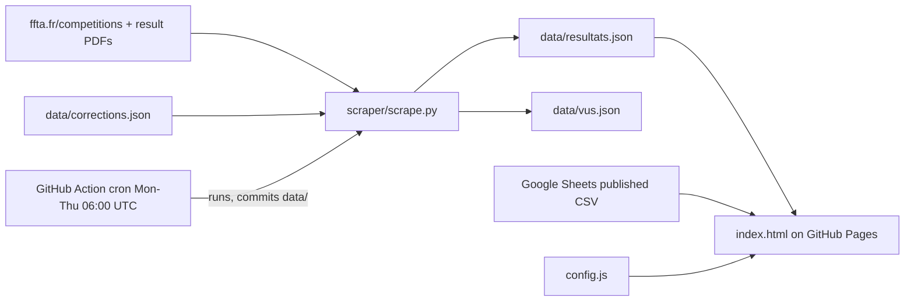

# Repository Guidelines

## Project Overview
TV/kiosk display for the archery club "Archers de l'Erdre" (Carquefou). It runs on a Raspberry Pi in Chromium kiosk mode and cycles through three kinds of screens:
- **Résultats**: weekend FFTA competition rankings for club archers, taken from the official PDFs.
- **Indisponible**: rooms or fields that are unavailable (from a Google Sheet).
- **À venir**: upcoming events (from a Google Sheet).

Everything is in French: UI text, identifiers, comments, commit messages and the README.

## Architecture & Data Flow

- **Static front end** (`index.html` + `config.js`): no build step and no npm. GitHub Pages serves `main` from `/` and is set up by hand, with no deploy workflow. Each data commit redeploys the site.
- **Scraper** (`scraper/scrape.py`): one Python file.
  - `lister_pdfs(debut, fin)` pages through the FFTA list and collects `a[href*=pdfresultats]` links.
  - `lire_pdf(bytes)` parses the PDF with pdfplumber and regexes (`LIGNE_RESULTAT`, `ENTETE_GROUPE`).
  - It re-ranks all archers in each category, then keeps only clubs listed in `CLUBS`.
  - `main()` merges results by `id` (the PDF URL), drops competitions that ended more than `JOURS_GARDES=10` days ago, and writes both JSON files.
- **Front-end pipeline**:
  1. `demarrer()` calls `construire()`.
  2. `construire()` runs `Promise.all` over `chercher()` for the JSON and the two CSVs.
  3. Each key in `CFG.ORDRE` is mapped through `parType[k]()`, producing slide objects `{el, source, debut}`.
  4. `installer()` puts the slides in the DOM.
  5. `afficher(i)` runs the `setTimeout` rotation.
  6. A `setInterval` every `RECHARGE_MINUTES` rebuilds the slides without resetting the rotation.

### Data contracts (keep in sync between scraper and `ecransResultats`)
```json
{ "maj": "YYYY-MM-DD",
  "concours": [{ "id": "<pdf url>", "nom": "...", "format": "Tir à 18m (2X18M)",
    "dates": "10 et 11 janvier 2026", "fin": "2026-01-11", "totalArchers": 132,
    "source": "Source : classement officiel FFTA du ...",
    "groupes": [{ "arc": "classique|poulies|nu", "titre": "U15 Femme",
      "lignes": [["Angèle CHALET", 1, 428]] }] }] }
```
- `data/vus.json`: sorted array of PDF URLs already processed. It is never pruned.
- `data/corrections.json`: `{"Nom formaté": "Nom corrigé"}`. Keys are names after `formater_nom` has run (`Prénom NOM`).
- CSV headers (lower-cased by `parseCSV`; must match `modele-tableur/*.csv`):
  - events: `date_debut,date_fin,heure,titre,lieu,details`
  - unavailabilities: `date_debut,date_fin,lieu,motif,solution`
  - dates are `YYYY-MM-DD` or `DD/MM/YYYY` (`lireDate`); rows with other formats are dropped.

## Key Directories
- `scraper/`: FFTA scraper and its `requirements.txt`.
- `data/`: JSON read by the page and written by the scraper. The bot commits here, so expect it to change upstream.
- `modele-tableur/`: CSV templates the club imports into Google Sheets. They are not read at runtime.
- `.github/workflows/resultats.yml`: the only workflow ("Résultats FFTA").

## Development Commands
```sh
pip install -r scraper/requirements.txt          # Python 3.12 in CI
python scraper/scrape.py                         # last 9 days, writes data/*.json (network)
CLUBS=CARQUEFOU,AUTRE python scraper/scrape.py   # several clubs, comma-separated
python scraper/scrape.py --debut 2026-01-10 --fin 2026-01-12
python scraper/scrape.py --tout                  # ignore vus.json and re-download PDFs
python scraper/scrape.py --pdf resultats.pdf     # parse a local PDF, print JSON, write nothing
python3 -m http.server                           # then open http://localhost:8000
```
- `file://` does not work because `fetch` of `data/resultats.json` is blocked. Always serve over HTTP.
- Left/right arrow keys or a click change the screen.
- CI runs the scraper with `CLUBS: "CARQUEFOU"`. To change the club, edit the workflow.

## Code Conventions & Common Patterns
- **Language**: French names everywhere. Examples:
  - JS: `chercher`, `construire`, `afficher`, `montrer`, `decouper`
  - Python: `lire_pdf`, `formater_nom`, `charger`
  - CSS: `.slide.actif`, `.entete`, `--or`, `--duree`
  - Keep this style for new code.
- **JS** (inline in `index.html`):
  - 2-space indent, double quotes, semicolons, modern ES (async/await, arrow functions, template literals).
  - Dense one-line helpers.
  - Sections are marked with `/* ---…--- outils */`-style separators.
- **Rendering**: HTML is built with template literals and set through `innerHTML`. Every interpolated text value MUST go through `esc()`.
- **Config**: `CFG = Object.assign({defaults}, window.CONFIG || {})`.
  - New settings go in `config.js`, and the default is repeated in `CFG`.
  - The README tells club users to edit only `config.js`, never `index.html`.
- **Error handling is silent by design**:
  - `chercher()` returns `null` on any failure, and that page type then yields no slides.
  - If no slides are left, the `vide` slide "Rien à afficher pour le moment" is shown.
  - In the scraper, one failed PDF is logged to stderr and skipped, and is not marked as seen, so the next run retries it.
  - A failed list page (`raise_for_status`) aborts the whole run.
- **State**: module-level variables only (`slides`, `courant`, `minuterie`). No framework.
- **Kiosk CSS**:
  - fluid `rem` (1rem = 16px at 1920×1080), `cursor: none`
  - a `(max-aspect-ratio: 1/1)` media query for phones
  - `prefers-reduced-motion` disables animations
  - test changes at 1920×1080
- **Scraper politeness**:
  - custom User-Agent
  - 0.5 s sleep between requests
  - timeouts: 30 s for list pages, 90 s for PDFs
  - keep these when adding requests
- JSON output uses `ensure_ascii=False, indent=1`.

## Important Files
- `index.html`: the whole front end: inline CSS, inline JS, and Google Fonts (Barlow).
- `config.js`: `window.CONFIG` with keys `CLUB_NOM`, `CLUB_LABEL`, `DUREE_SECONDES`, `RECHARGE_MINUTES`, `SHEET_EVENEMENTS_CSV`, `SHEET_INDISPOS_CSV`, `ORDRE`. An empty sheet URL hides that screen.
- `scraper/scrape.py`: the scraper.
- `data/resultats.json`: currently sample data (`exemple-carquefou-janvier-2026`). The first real run replaces it.
- `.github/workflows/resultats.yml`:
  - runs on cron `0 6 * * 1-4` and `workflow_dispatch`
  - needs `contents: write`
  - commits "Résultats mis à jour" only when `data/` changed
- `README.md`: French setup guide (Pages, Actions permissions, Sheets, Raspberry Pi kiosk, known limits).

## Runtime/Tooling Preferences
- Front end: plain browser JS. NEVER add npm, a bundler, a framework or JS CDNs.
- Scraper: Python 3.12 with `pip` and `requirements.txt` (`requests`, `beautifulsoup4`, `pdfplumber`). Versions are minimums only; there is no lockfile.
- No secrets. The only env var is `CLUBS`.

## Testing & QA
- There are no automated tests, linters, formatters or type checkers, and CI does no validation.
- Verify changes by hand:
  - **Parser changes**: run `python scraper/scrape.py --pdf <real FFTA PDF>` and check the JSON.
  - **Front-end changes**: serve with `python3 -m http.server`, then step through every screen type, including the empty state and long rankings split across several slides (`decouper`/`hauteur`, height budget 47rem).
  - **Data-shape changes**: update `lire_pdf`/`main` and `ecransResultats` together. A malformed `resultats.json` (for example, missing `groupes`) throws and leaves the screen blank on first load.
- Known limits:
  - Only "Classement Officiel" PDFs with per-round score columns parse correctly (18 m indoor and outdoor). Field, 3D and nature PDFs may give nothing.
  - The scraper has not been tested against the live FFTA site.
